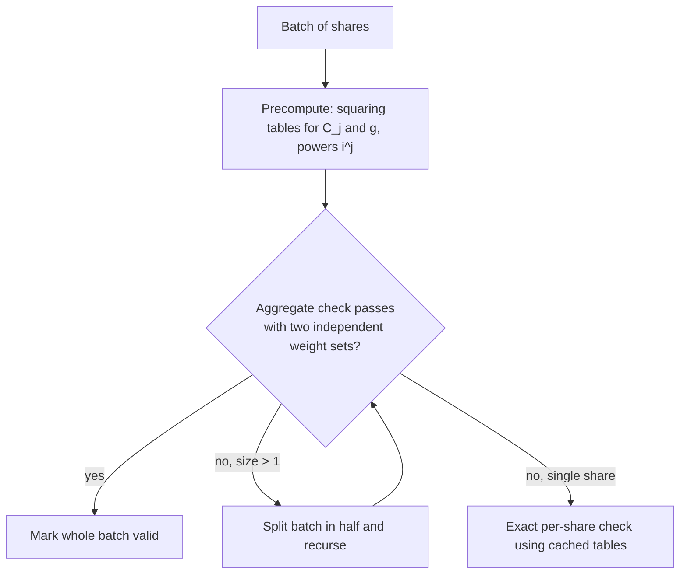
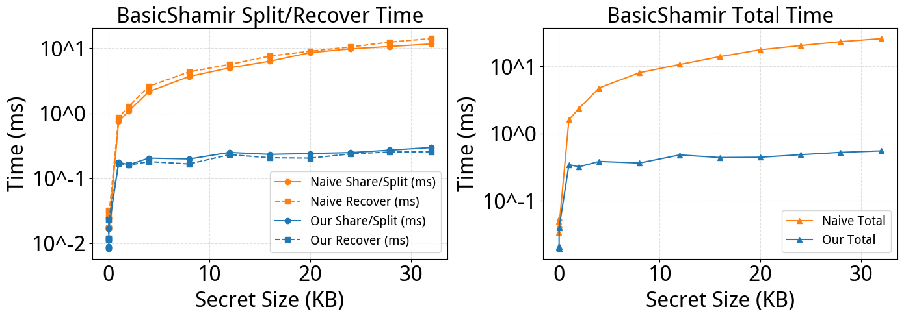
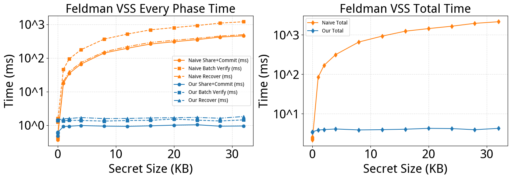

# Verifiable Multi-Party Secret Sharing

A Python implementation of Shamir secret sharing, Feldman verifiable secret sharing (VSS), proactive share refresh and hierarchical (HQ / region / branch) key management. It adds two optimizations: hybrid encryption for large secrets and fast batch verification of shares. A Flask web demo is included.

> Entry for the **2025 Huawei Hackathon Software Challenge** (October 2025), built by a team of three. See the [challenge page](https://www.chaspark.com/#/races/competitions/1189992027222327296).
> The organizers provided the API skeletons in [`templates/`](templates) and the test suite in [`tests/`](tests). The implementations in [`src/`](src), the benchmarks and the demo are the team's work.
> 中文说明见 [README.zh-CN.md](README.zh-CN.md).

Poster: [Poster.pdf](Poster.pdf)

## Overview

| Module | File | What it does |
| --- | --- | --- |
| Basic Shamir | [`src/basic_shamir.py`](src/basic_shamir.py) | (t, n) threshold sharing over a prime field. Adds hybrid AES-GCM mode for large secrets |
| Feldman VSS | [`src/feldman_vss.py`](src/feldman_vss.py) | Safe-prime group (p = 2q + 1), public commitments, per-share verification, complaints, batch verification |
| Proactive refresh | [`src/proactive_sharing.py`](src/proactive_sharing.py) | Periodic share refresh with zero-constant polynomials, so old shares become useless while the secret stays the same |
| Hierarchical sharing | [`src/hierarchical_sharing.py`](src/hierarchical_sharing.py) | Builds master, regional and branch keys with level-specific recovery policies on top of VSS and refresh |
| Web demo | [`src/app.py`](src/app.py), [`src/verifiable_secret_sharing_demo.html`](src/verifiable_secret_sharing_demo.html) | Interactive key creation, recovery, refresh and attack simulations |

Hierarchical recovery policies, as required by the challenge:

| Key level | Shares required to recover |
| --- | --- |
| Master key | HQ share + at least 3 regional shares |
| Regional key | Regional-center shares + at least 60% of that region's branch shares |
| Branch key | Any 3 branch shares |

## Highlights

### Large secrets with hybrid encryption

Plain Shamir can only share a secret that fits in one field element: 30 bytes with the default 256-bit prime. The team compared two ways around this:

- **Chunking** (the baseline, [`performance_test/basic_task1.py`](performance_test/basic_task1.py)): split the secret into blocks and run an independent Shamir instance on each block. Cost and share size grow linearly with the secret size.
- **Hybrid** (final, `_split_secret_hybrid`): encrypt the secret once with a fresh AES-GCM key, then Shamir-share only that key. The AES key length (128, 192 or 256 bits) is chosen to fit the field. The ciphertext, nonce and tag go along as public metadata. `split_secret` / `recover_secret` choose the mode automatically, so the API does not change.

### Batch verification of Feldman shares

Checking each share on its own costs about t modular exponentiations per share. `batch_verification` uses a **random linear combination** check instead:

$$g^{\sum_i r_i s_i} \equiv \prod_{j=0}^{t-1} C_j^{\sum_i r_i \cdot i^j} \pmod p$$

This checks a whole set of shares at once with about t exponentiations. The full procedure:



When all shares are honest, the cost is a few aggregate checks. When some shares are bad, the bisection isolates them, and each isolated share gets an exact individual check.

### Proactive refresh and attack demo

Refresh follows the standard proactive scheme: each participant deals a random polynomial with constant term 0, and every share is updated by adding the sum of these deltas. The secret stays the same, but shares from an earlier epoch can no longer be combined with current ones. The web demo runs four attacks against the system and shows how each one is stopped:

- a tampered share
- too few shares to meet the threshold
- cross-level share mixing
- reuse of a stale share after a refresh

## Project Structure

```
.
├── src/                 # Team implementation (+ Flask demo)
├── templates/           # Official API skeletons (provided)
├── tests/               # Basic/extended test suites (provided, partly adapted by the team)
│                        #   + team-written extended/comprehensive_test.py
├── performance_test/    # Chunking/naive baselines, benchmark script, result plots
├── Poster.pdf           # Competition poster
├── 性能报告.pdf          # Performance report (Chinese)
├── 简要说明文档.pdf       # Short design description (Chinese)
└── README.zh-CN.md      # Original Chinese README
```

During the competition the team adapted some of the provided files. For example, `ProactiveSecretSharing` now takes the Feldman VSS instance, and `templates/` and `tests/basic/` were updated to match.

## Build & Run

Python 3.10 is recommended (the pinned versions in `requirements.txt` may not install on much newer Python versions).

```bash
python3 -m venv .venv
source .venv/bin/activate
pip install -r requirements.txt
```

```bash
# Run the basic + extended test suites
python tests/run_tests.py

# Benchmark the final implementation against the chunking/naive baselines
# (writes shamir.png and feldman.png to the current directory)
python performance_test/benchmark_secret_sharing.py

# Start the web demo, then open http://localhost:5001
python src/app.py
```

All suites in `tests/` pass (4/4 basic, 2/2 extended).

> The demo server runs Flask in debug mode and listens on `0.0.0.0`. Use it only on a trusted local machine.

## Results

Benchmark: [`performance_test/benchmark_secret_sharing.py`](performance_test/benchmark_secret_sharing.py) with its default settings (256-bit prime, n = 10, t = 4, 100 rounds per size). "Naive" is the team's own baseline: chunked Shamir with one-by-one Feldman verification ([`basic_task1.py`](performance_test/basic_task1.py), [`basic_task2.py`](performance_test/basic_task2.py)).

| BasicShamir | Feldman VSS |
| --- | --- |
|  |  |

These are approximate values read from the log-scale plots, for a 32 KB secret:

| Total time (split + recover [+ verify]) | Naive | Final implementation |
| --- | --- | --- |
| BasicShamir | ~25 ms | ~0.5 ms |
| Feldman VSS | ~2 s | ~4 ms |

The final implementation's time stays roughly flat as the secret grows. The baseline's time grows with the secret size. The full write-up (in Chinese) is in [性能报告.pdf](性能报告.pdf).

**Known limitation:** with the default 256-bit field, secrets longer than 30 bytes but shorter than 1024 bytes are rejected with `Secret too large`. Only small secrets (≤ `block_size`) and large secrets (≥ 1 KB) are supported.

## Team & Acknowledgements

- Boning Huangfu (皇甫泊宁), [@smiling689](https://github.com/smiling689)
- Yilai Chen (陈奕莱), [@cyl06](https://github.com/cyl06)
- Shi Zhuo (卓识)

Shanghai Jiao Tong University. Problem statement, API templates and the original test suite by the Huawei Hackathon 2025 organizers.

References: A. Shamir, *How to Share a Secret* (1979); P. Feldman, *A Practical Scheme for Non-interactive Verifiable Secret Sharing* (1987); A. Herzberg et al., *Proactive Secret Sharing, Or: How to Cope With Perpetual Leakage* (1995).
